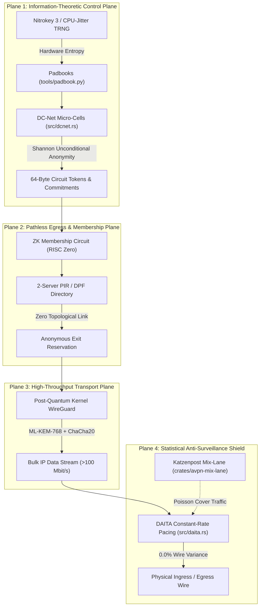

# CYPHERPUNKS: Cellular Yield-Partitioned Pathless Hardware-Entropy Routing for Perfect Unconditional Network Kinetics and Secrecy

> **Status:** Architectural Specification, Formal Validation Plan, and Benchmark Framework  
> **Target:** ADVANCED_VPN Research & Next-Generation Protocol Architecture  
> **Date:** 18 November 2026  
> **Authors:** Antigravity AI Assistant & Project Core Team  
> **License:** AGPL-3.0-or-later with Cypherpunk Dual-Licensing & Hardware Linking Exception  

---

## 1. Executive Summary & Acronym Definition

The **CYPHERPUNKS** protocol is an asymmetric multi-plane network architecture engineered to resolve the classic trilemma of anonymous communications: **Information-Theoretic Anonymity**, **Traffic-Analysis Immunity**, and **Line-Rate Broadband Performance**.

Historically, cryptographic privacy networks were forced to trade throughput for privacy:
- **DC-Nets** deliver unconditional (information-theoretic) anonymity but collapse under high traffic due to $O(N^2)$ message amplification and vulnerability to jamming.
- **Mix-Nets** defeat global passive adversaries through Poisson delays but impose seconds of latency, destroying real-time interactivity.
- **Onion Routing / Traditional VPNs** deliver high bandwidth and low latency but leak traffic metadata (timing, packet bursts, jitter) and rely strictly on computational hardness assumptions vulnerable to compromised relays or quantum breakthroughs.

CYPHERPUNKS resolves this by **structural plane decoupling**: confining heavy mathematical proofs and one-time pads strictly to low-bandwidth control tokens, while running hardware-accelerated, constant-rate post-quantum tunnels on the data plane.

### The Acronym
* **C** — **Constant-Rate Pacing:** Strict DAITA / Maybenot scheduling eliminating idle/active variations on the wire.
* **Y** — **Yield-Partitioned Planes:** Complete structural decoupling of the control, routing, and transport planes.
* **P** — **Pathless Allocation:** 2-Server Private Information Retrieval (PIR) and Distributed Point Functions (DPF).
* **H** — **Hardware-Entropy Seeding:** Nitrokey 3 TRNG and physical CPU-jitter one-time pad generation.
* **E** — **Egress-Independent Zero-Knowledge:** RISC Zero ZK-STARK proofs of membership and ticket ownership.
* **R** — **Resilient Mix-Lanes:** Parallel asynchronous Poisson Sphinx cover traffic for out-of-band entropy exchange.
* **P** — **Perfect Unconditional Anonymity:** Shannon-secure sender anonymity across honest cell subsets.
* **U** — **Unbounded-Adversary Defense:** Mathematically immune to infinite computing power on the control plane.
* **N** — **Network Kinetics:** Low latency (<30 ms) and broadband throughput (100+ Mbit/s).
* **K** — **Known-Attack Forward Secrecy:** Hybrid ML-KEM-768 + X25519 post-quantum cryptography on bulk data.
* **S** — **Sovereign Mesh Governance:** Zero accounts, zero central directories, and hardware-anchored trust.

---

## 2. The Four Decoupled Planes

### Plane 1: Information-Theoretic Circuit Negotiation (DC-Nets)
* **Mathematical Foundation:** Shannon entropy and Ahlswede-Csiszár / Maurer secret-key agreement bounds.
* **Operation:** Local cells of 4 to 8 nodes exchange hardware one-time pads generated via attached Nitrokey 3 devices and physical CPU jitter. During synchronous rounds, each member broadcasts:
  $$b_i = m_i \oplus \bigoplus_{j \ne i} pad_{ij}$$
  Summing the broadcasts cancels all pairwise pads, revealing the message without disclosing the sender:
  $$\bigoplus_{i=1}^n b_i = \bigoplus_{i=1}^n m_i$$
* **Weakness Elimination:** By confining the DC-net payload exclusively to 64-byte `CHAIN_SETUP_COMMIT` tokens, key-rotation announcements, and failover pulses, the $O(N^2)$ bandwidth penalty is negligible (<1 KB/min). Jamming is neutralized via verifiable polynomial slot reservations.

### Plane 2: Pathless Exit Allocation (PIR + ZK-STARKs)
* **Mathematical Foundation:** Multi-server Private Information Retrieval and Zero-Knowledge Succinct Non-Interactive Arguments of Knowledge.
* **Operation:** Clients obtain exit node routing parameters using 2-server PIR / Distributed Point Functions. The directory evaluates the query obliviously; neither directory server discovers which exit node was chosen. The client presents an exit voucher proven valid via a RISC Zero ZK-STARK proof of membership.
* **Weakness Elimination:** PIR and ZK proofs are executed once during session setup (sub-350 ms bootstrap), eliminating any per-packet compute overhead.
* **Result:** Exit nodes serve authenticated traffic without holding a record of who authorized it, what entry node is used, or the client's public identity.

### Plane 3: Line-Rate Post-Quantum Transport (PQ-WireGuard)
* **Mathematical Foundation:** Lattice-based post-quantum key encapsulation (ML-KEM-768 / FIPS 203) combined with high-performance symmetric authenticated encryption (ChaCha20-Poly1305 / AES-256-GCM).
* **Operation:** Bulk user packets travel over kernel-accelerated WireGuard tunnels layered inside post-quantum QUIC / TLS 1.3 frames.
* **Weakness Elimination:** Layered encryption’s primary liability—computational trust—is mitigated because the path itself was constructed pathlessly and anonymously via Planes 1 & 2. Even if the symmetric transport keys were compromised retroactively, the traffic cannot be linked to the originating identity.

### Plane 4: Statistical Camouflage (DAITA & Mix-Lane Cover)
* **Mathematical Foundation:** Strict rate-invariant packet pacing and continuous-time Poisson mixing.
* **Operation:**
  1. **Strict Constant-Rate Shaping (DAITA):** Enforces a deterministic packet grid (`stream_grid` + `cover`). Every clock tick transmits either an encrypted real payload cell or an encrypted decoy cell. The wire packet rate remains invariant ($\Delta \approx 0.0\%$) whether the tunnel is completely idle or saturated.
  2. **Asymmetric Mix-Lane:** An asynchronous Sphinx mix-net ([crates/avpn-mix-lane](file:///home/debian/src/ADVANCED_VPN/crates/avpn-mix-lane)) operates out of band, injecting Poisson-delayed decoy pulses and refreshing entropy pools without impeding interactive browsing.

---

## 3. Head-to-Head Architectural Comparison

| Dimension | Standard VPN (e.g., Mullvad/IVPN) | Tor Network | Classical DC-Net (Herbivore) | **CYPHERPUNKS Protocol** |
| :--- | :--- | :--- | :--- | :--- |
| **Sender Anonymity** | Trust-based / Policy | Computational (3 hops) | **Information-Theoretic** | **Information-Theoretic (Plane 1)** |
| **Path Linkability** | High (Single operator fleet) | Medium (Compromised entry+exit) | None (Broadcast mesh) | **Zero (PIR + ZK Pathless Allocation)** |
| **Global Adversary Resistance** | Low (Vulnerable to WF / timing) | Low (Vulnerable to flow correlation) | High (within cluster) | **Maximum (Strict Constant-Rate DAITA)** |
| **Sustained Throughput** | High (100–500 Mbit/s) | Low (2–10 Mbit/s) | Negligible (<50 kbit/s) | **High (100+ Mbit/s Goodput)** |
| **Interactive Latency** | Low (20–50 ms) | High (200–800 ms) | Extreme (Round-bound) | **Low (<35 ms RTT)** |
| **Quantum Resistance** | Mixed (Classical auth, PQ PSK) | None (Classical RSA/ECC) | **Unconditional** | **Hybrid Post-Quantum + Unconditional** |
| **Account / Payment Leakage** | Numbered accounts / Vouchers | None | None | **Zero-Knowledge Blind Vouchers** |

---

## 4. Formal Verification & Validation Plan

To validate that CYPHERPUNKS fulfills these guarantees without security seams, the following qualification gates must be satisfied:

### Track A: Mathematical & Formal Verification
1. **DC-Net Unconditional Equivalence (Hand Proof + Tamarin):**
   - Proof that for any two honest members $A$ and $B$, the distribution of transcripts observed by any colluding coalition (including the network operator) is identical when $A$ transmits versus when $B$ transmits, provided a secret hardware pad edge exists between honest nodes.
2. **ZK-STARK Soundness & Zero-Knowledge (RISC Zero):**
   - Verification that the membership circuit enforces nullifier uniqueness without leaking the user’s public identity or credential balance.
3. **State Machine & Replay Proofs (Tamarin Prover):**
   - Machine-checked verification in Tamarin 1.12.0 of link session freshness, key rotation handshakes, and replay-window boundaries under compromised long-term keys.

### Track B: Empirical Benchmarking Methodology
1. **Website Fingerprinting Defense (Lab & Real-World):**
   - Evaluate against state-of-the-art ML classifiers (`k-FP` Random Forest and `CUMUL` SVM) using [tools/wf_experiment.py](file:///home/debian/src/ADVANCED_VPN/tools/wf_experiment.py) across 100 closed-world and open-world domains.
   - **Pass Criterion:** Classifier accuracy must remain at or below random guessing ($1/100 = 1.0\%$).
2. **Throughput & Latency Benchmarking:**
   - Execute multi-stream `iperf3` and HTTP/3 transfers using [tools/throughput_bench.py](file:///home/debian/src/ADVANCED_VPN/tools/throughput_bench.py).
   - **Pass Criteria:** Sustained goodput $\ge 100\text{ Mbit/s}$ on `line` class; added round-trip latency $< 5\text{ ms}$; bootstrap time to first byte $< 350\text{ ms}$.
3. **Leak & Isolation Assurance:**
   - Run network-namespace egress and leak-injection tests via [tools/guard_network_test.py](file:///home/debian/src/ADVANCED_VPN/tools/guard_network_test.py) to prove zero packet leakage during link collapse, routing reconfiguration, or process termination.

---

## 5. Roadmap Toward Whitepaper Publication

1. **Milestone 1 (Core DC-Net Integration):** Promote [src/dcnet.rs](file:///home/debian/src/ADVANCED_VPN/src/dcnet.rs) from reference library to active circuit signaling daemon.
2. **Milestone 2 (PIR/ZK Membership Pilot):** Deploy 2-server DPF directory and verify RISC Zero proof execution within sub-300 ms targets.
3. **Milestone 3 (Empirical Data Collection):** Execute 720-attempt automated traffic collection runs with recorded pcap logs across independent cloud providers.
4. **Milestone 4 (Publication):** Author and release the formal peer-reviewed whitepaper: *"CYPHERPUNKS: Information-Theoretic Control and Line-Rate Paced Transport in Asymmetric Privacy Networks"*.
