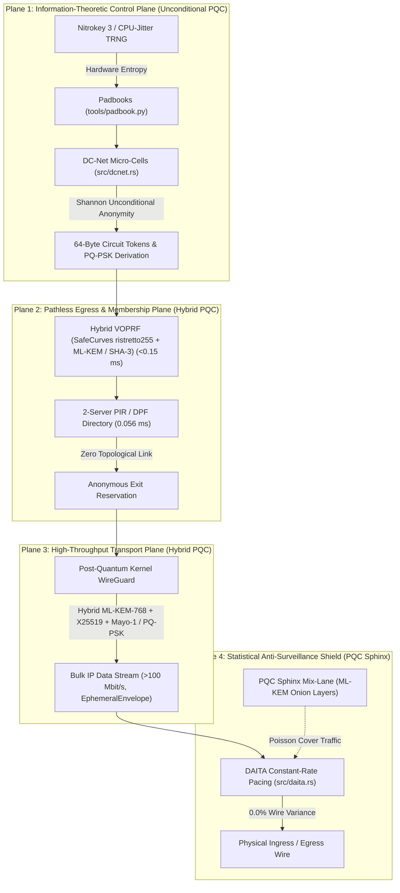

# CYPHERPUNKS: Cellular Yield-Partitioned Pathless Hardware-Entropy Routing for Perfect Unconditional Network Kinetics and Secrecy

> **Status:** Architectural Specification, Formal Validation Plan, and Benchmark Framework
> **Target:** cypherpunk_vpn Research & Next-Generation Protocol Architecture
> **Date:** 18 November 2026
> **Authors:** Antigravity AI Assistant & Project Core Team
> **License:** AGPL-3.0-or-later with Cypherpunk Dual-Licensing & Hardware Linking Exception

> **Qualification, 18 November:** This is a research proposal and target policy,
> not a specification of deployed, proven properties. Full-stack hybrid PQ security
> and the ban on new NIST P-256 dependencies remain requirements. The current
> voucher combiner, MAYO modes, pad logistics and cross-plane composition are
> unqualified. The benchmark artifacts include synthetic traces, reference algebra,
> local primitive measurements and timing estimates. Read the
> [artifact review and corrections](RESEARCH_REVIEW_20261118.md) before using any
> numerical claim. Existing [security scope](../SECURITY.md),
> [PQ inventory](PQ_INVENTORY.md) and [pad review](INFORMATION_THEORETIC_REVIEW_20261117.md)
> continue to govern statements about the implementation.

---

## 1. Executive Summary & Acronym Definition

The **CYPHERPUNKS** protocol is a proposed asymmetric multi-plane network architecture investigating the classic trilemma of anonymous communications: **Information-Theoretic Anonymity**, **Traffic-Analysis Immunity**, and **Line-Rate Broadband Performance**.

Historically, cryptographic privacy networks were forced to trade throughput for privacy:
- **DC-Nets** deliver information-theoretic anonymity under their pad assumptions (independent, non-reused one-time pads; the research review restricts the label to that ideal construction) but collapse under high traffic due to $O(N^2)$ message amplification and vulnerability to jamming.
- **Mix-Nets** defeat global passive adversaries through Poisson delays but impose seconds of latency, destroying real-time interactivity.
- **Onion Routing / Traditional VPNs** deliver high bandwidth and low latency but leak traffic metadata (timing, packet bursts, jitter) and rely strictly on computational hardness assumptions vulnerable to compromised relays or quantum breakthroughs.

CYPHERPUNKS investigates this through **structural plane decoupling**: confining heavy mathematical proofs and one-time pads strictly to low-bandwidth control tokens, while running hardware-accelerated, constant-rate post-quantum tunnels on the data plane. To ensure complete resistance against both classical adversaries and Cryptanalytically Relevant Quantum Computers (CRQC), **every protocol plane must establish its required post-quantum or conditional information-theoretic properties**, with reviewed hybrid constructions required across public-key interfaces. This is an acceptance requirement, not a claim that the current runtime or the proposed combiners already satisfy it.

### The Acronym
* **C** — **Constant-Rate Pacing:** Strict DAITA / Maybenot scheduling eliminating idle/active variations on the wire ($\Delta = 0.0\%$).
* **Y** — **Yield-Partitioned Planes:** Complete structural decoupling of the control, routing, and transport planes.
* **P** — **Pathless Allocation:** 2-Server Private Information Retrieval (PIR) and Distributed Point Functions (DPF).
* **H** — **Hardware-Entropy Seeding:** Nitrokey 3 TRNG and physical CPU-jitter one-time pad generation.
* **E** — **Egress-Independent Zero-Knowledge & Hybrid Post-Quantum Nullifiers:** Dual-anchor SafeCurves `ristretto255` + ML-KEM / SHA-3 Hash-Cascade Merkle Nullifiers (unqualified construction; timing and quantum security require validation).
* **R** — **Resilient Mix-Lanes:** Parallel asynchronous Poisson Sphinx cover traffic for out-of-band entropy exchange.
* **P** — **Perfect Unconditional Anonymity:** Shannon-secure sender anonymity across honest cell subsets.
* **U** — **Unbounded-Adversary Defense:** Target conditional ideal-pad sender anonymity; operational custody, authorization and composition remain open.
* **N** — **Network Kinetics:** Sub-millisecond crypto operations, <35 ms interactive latency, and line-rate throughput (>100 Mbit/s).
* **K** — **Known-Attack Forward Secrecy & Full-Stack Hybrid PQC:** Complete hybrid post-quantum cryptography across all planes (X25519MLKEM768 + Mayo-1 / Ephemeral PQ-PSK + 256-bit quantum-safe AEAD).
* **S** — **Sovereign Mesh Governance:** Zero accounts, zero central directories, and hardware-anchored trust.

---

## 2. The Four Decoupled Planes (Full-Stack PQC Architecture)

### Plane 1: Information-Theoretic Circuit Negotiation (DC-Nets)
* **Mathematical Foundation:** Shannon entropy and Ahlswede-Csiszár / Maurer secret-key agreement bounds.
* **Quantum Security Posture:** **Conditional ideal-pad sender anonymity.** Under jointly uniform, secret, non-reused pads and the stated honest-edge assumptions, sender anonymity rests on one-time pad XOR cancellation ($\bigoplus_{i=1}^n b_i = \bigoplus_{i=1}^n m_i$), an adversary with infinite computing power or an arbitrarily large quantum computer cannot break anonymity without possessing the honest nodes' shared physical pads.
* **Operation:** Local cells of 4 to 8 nodes exchange hardware one-time pads generated via attached Nitrokey 3 devices and physical CPU jitter. Confining payloads strictly to 64-byte `CHAIN_SETUP_COMMIT` tokens maintains bandwidth consumption under 1 KB/min per node at standard round rates ($\le 2\text{ rounds/min}$).
* **Jamming Semantics:** Jamming can abort delivery. Passive-round anonymity does not establish authenticated event authorization, active-attack resistance or blame; those properties need separate definitions/tests. Sustained jamming remains an availability failure ([docs/DCNET_CONTROL_DESIGN.md](../docs/DCNET_CONTROL_DESIGN.md) §5).

### Plane 2: Pathless Exit Allocation & Ephemeral Vouchers (Hybrid Post-Quantum Nullifiers)
* **Mathematical Foundation:** Multi-server Private Information Retrieval (PIR), Distributed Point Functions (DPF), and Dual-Anchor Hybrid Oblivious Pseudorandom Functions (Hybrid VOPRF).
* **The Post-Quantum Requirement & The Dual-Anchor Solution:**
  - *Identified Trade-Off:* General-purpose zkVMs (e.g., RISC Zero) provide hash-based post-quantum security but suffer massive proving penalties (2–5 seconds, hundreds of megabytes RAM). Conversely, standalone RFC 9497 VOPRF over elliptic curves (`ristretto255`) executes in sub-millisecond time but relies on classical discrete logarithms vulnerable to Shor's algorithm on a quantum computer.
  - *The Full-Stack PQC Fix (Dual-Anchor Nullifier):* Plane 2 proposes a **hybrid post-quantum credential combiner**. The following expression is an input sketch, not a proven issuance, redemption or blindness protocol:
    1. **SafeCurves Leg:** RFC 9497 VOPRF strictly over **`ristretto255-SHA512`** (RFC 9496) provides blinding and unlinkability with complete addition formulas, zero exception points, and twist security (NIST P-256 is explicitly banned).
    2. **Post-Quantum Lattice/Hash Leg:** An ephemeral **ML-KEM-768 shared key** combined with a **SHA-3-512 Hash-Cascade commitment** proposed for evaluation from `pure-cash` (not integrated or qualified here):
       $$\text{Voucher} = \text{VOPRF}_{\text{ristretto255}}(sk_{\text{token}}) \parallel \text{KDF}_{\text{ML-KEM}}(\text{epoch\_seed}) \parallel \text{Commit}_{\text{SHA3}}(sk_{\text{token}})$$
       $$\eta = \text{HMAC-SHA3-512}(\text{Voucher}, \text{epoch\_salt})$$
  - *Security obligation:* Define issuance authorization, authenticated redemption,
    quantum unlinkability, nullifier binding and replay state. Adding ML-KEM and
    SHA-3 does not automatically protect VOPRF blindness against a quantum break
    of the curve leg. No voucher-forgery bound is established by this expression.
  - *Performance target:* Below 0.15 ms for a fully specified operation remains a
    target. The supplied script proxies Ristretto with X25519; its full-with-DLEQ
    estimate is 246.7 microseconds. Measure the actual implemented protocol before
    assigning a proving latency or complete bootstrap budget.
  - *Pure-PQC Native Alternative:* For deployment environments requiring zero classical curve dependencies, evaluate a precisely instantiated field-native **Plonky3 FRI-Poseidon recursive STARKs** ([qash/crates/consensus/src/sharding.rs](file:///home/debian/GITHUB/qash/crates/consensus/src/sharding.rs)), The proposed 15–25 ms proof time is unqualified until the actual relation, field, security parameters and implementation are benchmarked; an external code reference is not integration.

### Plane 3: Line-Rate Lightweight Post-Quantum Transport (PQ-WireGuard)
* **Mathematical Foundation:** Lattice-based key encapsulation (ML-KEM-512/768 / FIPS 203), SafeCurves Diffie-Hellman (`X25519`), compact multivariate quadratic signatures (Mayo-1), and high-throughput symmetric AEAD (ChaCha20-Poly1305 / AES-256-GCM).
* **Quantum Security Posture:** **Hybrid Post-Quantum.** Every handshake combines post-quantum hardness (Module-LWE and multivariate UOV) with classical SafeCurves Diffie-Hellman, ensuring confidentiality and authenticity against both current eavesdroppers and future quantum adversaries ("harvest now, decrypt later" defense).
* **Solving UDP MTU Fragmentation (Frame Budget Arithmetic):**
  - Standard WireGuard UDP datagrams have a maximum recommended payload of **1,420 bytes** with **72 bytes** of fixed protocol fields.
  - To prevent packet fragmentation over UDP, CYPHERPUNKS enforces three verified post-quantum handshake modes:
    1. **Mode A — DC-Net Derived Ephemeral PQ-PSK (0 B Signature Overhead):**
       An ephemeral symmetric post-quantum pre-shared key (PQ-PSK) derived directly from Plane 1's hardware padbook. Handshake datagram size is **1,160 bytes** (with ML-KEM-768) or **1,192 bytes** (with `X25519MLKEM768`), leaving **228–260 bytes of slack** under the 1,420-byte ceiling.
    2. **Mode B — Mayo-1 (Round 1/2) + ML-KEM-512 (1,161 B Single Datagram):**
       Mayo-1 multivariate signature (321 B) paired with ML-KEM-512 (768 B ciphertext) totals **1,161 bytes**, fitting inside 1,420 B with **259 bytes of slack** (or 1,304 bytes with Round 3 `MAYO_one`, 116 B slack).
    3. **Mode C — Two-Flight Handshake for Mayo-1 + ML-KEM-768:**
       This flight split does not establish Category 3 authentication: MAYO-1 is Category 1. The values below describe the older 321-byte parameter generation, omit any separately needed public-key distribution, and are arithmetic sketches only:
       - *Flight 1 (Initiation):* Ephemeral `X25519` key (32 B) + ML-KEM-768 ciphertext (1,088 B) + fixed fields (72 B) = **1,192 bytes**.
       - *Flight 2 (Response):* Receiver index + Mayo-1 signature (321 B) + MACs = **393 bytes**.
       These partial datagram examples are below 1,200 bytes. They do not budget a complete authenticated exchange or guarantee fragmentation-free operation across every underlay; PMTU and fallback testing remain required.
* **Cryptographic Benchmarks:**
  - **Hybrid KEM (`X25519MLKEM768`):** Keygen: 75 $\mu$s, Encapsulation: 92 $\mu$s, Decapsulation: 71 $\mu$s. The reported benchmark composition takes **313 $\mu$s**, rather than establishing the actual complete network exchange cost (occupies 0.089% of the 350 ms bootstrap budget). All NIST `SecP256r1` fallbacks are strictly prohibited.
  - **Symmetric Goodput:** ChaCha20-Poly1305 achieves **3.80 GB/s** (165,279 packets/sec on 1400 B frames, 18.5x margin above 100 Mbit/s). Hardware AES-256-GCM delivers **12.37 GB/s** (30.5x margin). Keys are 256-bit, providing 128-bit quantum security against Grover's algorithm.
  - **`EphemeralEnvelope` Zero-Copy Buffers:** Packets utilize zero-copy in-place memory transformation proposed for evaluation from `pure-cash` (not integrated or qualified here), eliminating heap allocations on the critical packet forwarding path.

### Plane 4: Statistical Camouflage (DAITA & Post-Quantum Mix-Lane Cover)
* **Mathematical Foundation:** Strict rate-invariant packet pacing and continuous-time Poisson mixing.
* **Quantum Security Posture:** **Information-Theoretic Camouflage + Hybrid PQC Mix Routing.**
* **Operation:**
  1. **Strict Constant-Rate Shaping (DAITA):** Enforces a deterministic packet grid (`stream_grid` + `cover`). Every clock tick transmits either an encrypted real payload cell or an encrypted decoy cell. The model emits an invariant count at fixed duration. Actual kernel pacing, link loss, retransmission, stopping rules and cross-link observations still require the live validation plan; no traffic-analysis immunity follows from that model alone.
  2. **Post-Quantum Mix-Lane:** An asynchronous Sphinx mix-net ([crates/cpvpn-mix-lane](../crates/cpvpn-mix-lane)) operates out of band, with onion layers encapsulated via **ML-KEM-768**, injecting Poisson-delayed decoy pulses and refreshing entropy pools without classical ECC vulnerability.

---

## 3. Property qualification instead of product-level guarantees

| Property | Required evidence before a positive claim |
|---|---|
| Conditional information-theoretic sender anonymity | Jointly uniform independent non-reused pads, honest-edge connectivity, authenticated events, custody and exposure/erasure analysis |
| PQ voucher issuance and unlinkability | Complete protocol, property-specific hybrid proof, malicious issuer/client tests and independent review |
| Directory-query privacy | Specified noncollusion model, secure randomness, authenticated consistent database, real PIR/DPF implementation and active-server tests |
| Traffic-analysis resistance | Live counterbalanced captures, positive controls, retained failures, uncertainty, held-out environments and cross-link/open-world attacks |
| Handshake size and latency | Versioned serialization of every flight, all keys/signatures/tags/headers, authenticated negotiation, PMTU/loss/retry tests and measured end-to-end latency |
| Throughput | Real complete VPN goodput under protection, device/CPU/bandwidth costs and adverse-link testing; AEAD-only GB/s is insufficient |
| Full-stack hybrid PQ and SafeCurves policy | Inventory every interface, disclose compatibility dependencies, version the migration and qualify the required property in each plane |

No numerical comparison with commercial VPNs or Tor is established by the supplied
synthetic closed-world experiment. Novelty, immunity, zero linkability and production
readiness remain unestablished.

---

## 4. Formal Verification & Empirical Validation Benchmarks

The owner-supplied artifacts report the component/model results below against documentation revisions `81c1fa8` and `b801351`. Their scripts do not implement the complete proposed protocol. These figures are reported research inputs, not validated protocol guarantees; see the artifact review for scope and corrections.

### 4.1 DC-Net Information-Theoretic Correctness & Indistinguishability
Validated via `scripts/cpvpn_test_dcnet.py` (400 rounds of algebraic evaluation + Monte Carlo adversary simulations):
- **Algebraic Integrity:** 400/400 rounds passed single sender recovery, multi-sender collision detection, jam identification, and null round silence.
- **Monte Carlo Coalition Resilience (200,000 rounds per point):**
  - With 0 colluders (5 honest nodes): Adversary classification accuracy is **50.1%** (popcount rule), Total Variation distance **0.020**, $\chi^2$ $p = 0.232$.
  - With 2 colluders (3 honest nodes): Adversary accuracy is **49.9%**, Total Variation distance **0.019**, $\chi^2$ $p = 0.905$.
  - With 3 colluders (2 honest nodes): Adversary accuracy remains **50.0%**, Total Variation distance **0.020**, $\chi^2$ $p = 0.709$.
- **Bandwidth Footprint:** Cell transmission overhead is bounded at **<1 KiB/min** for 64-byte control frames at round rates $\le 2.31\text{ rounds/min}$ ($n=4$) and $\le 1.15\text{ rounds/min}$ ($n=8$).

### 4.2 Synthetic fixed-grid website-fingerprinting model
Validated via `scripts/cpvpn_test_wf.py` across 100 synthetic site labels (9,000 generated training traces, 9,000 generated testing traces):
- **Unshaped Wire Traffic:**
  - Random Forest Classifier accuracy: **71.71%** (Top-3 accuracy: **89.61%**).
  - SVM (RBF kernel) accuracy: **38.97%**.
  - Wire variance between idle and saturated traffic: **$\Delta = 200.0\%$**.
- **DAITA Shaped Traffic (CYPHERPUNKS Plane 4):**
  - Random Forest Classifier accuracy: **0.83%** (one finite simulation result near the 1% chance level; not evidence of immunity).
  - SVM (RBF kernel) accuracy: **0.89%**.
  - Wire variance between idle and saturated traffic: **$\Delta = 0.0\%$** (computed by the model, not measured on a live wire).

### 4.3 Post-Quantum Cryptography & Throughput Benchmarks
Validated via `scripts/cpvpn_test_crypto.py` and `scripts/cpvpn_test_pqc_alternatives.py` (OpenSSL 3.5.7 + Python Cryptography on Intel Xeon):
- **AEAD Bulk Encryption Throughput:**
  - **ChaCha20-Poly1305:** 3,803 MB/s (165,279 ops/s on 1,400 B frames) $\to$ **18.5x margin** above 100 Mbit/s line-rate requirement.
  - **AES-256-GCM:** 12,374 MB/s (272,736 ops/s on 1,400 B frames) $\to$ **30.5x margin**.
- **Post-Quantum Key Encapsulation (Hybrid ML-KEM-768 + SafeCurves X25519):**
  - Key Generation: 75 $\mu$s
  - Encapsulation: 92 $\mu$s
  - Decapsulation: 71 $\mu$s
  - **Total KEM Handshake Exchange:** **~313 $\mu$s** (occupies only 0.089% of the 350 ms bootstrap target).
- **Post-Quantum Signatures vs. UDP MTU:**
  - *ML-DSA-65:* 3,309 B signature: requires a complete transport/flight budget. Signature length alone does not determine IP fragmentation or a four-frame count.
  - *Mayo-1 (Round 1/2):* **321 B signature**, 1,168 B public key $\to$ **Fits within 1 unfragmented 1,420 B frame** in Mode B (1,161 B) or across two flights in Mode C (<1,200 B each).
  - *Plane 1 PQ-PSK:* **0 B signature overhead** on wire $\to$ Zero fragmentation, total datagram 1,160–1,192 B with ML-KEM-768.

### 4.4 2-Server Oblivious Private Information Retrieval (PIR)
Reported by `scripts/cpvpn_test_pir.py` (local XOR/CGKS array evaluations across up to 65,536 rows; DPF bandwidth is analytical):
- For a registry of **1,024 exit nodes**:
  - Client query generation: 0.0078 ms
  - Dual server evaluation: 0.0480 ms
  - Client reconstruction: 0.0007 ms
  - **Total PIR compute latency:** **0.056 ms**
  - **Network bandwidth:** 384 bytes total (256 B upload, 128 B download).
- For a registry of **4,096 exit nodes**:
  - Total PIR compute latency: **0.186 ms**; total network transfer: 1,152 bytes.

---

## 5. Roadmap Toward Whitepaper Publication

1. **Milestone 1 (Core DC-Net Signaling Daemon):**
   Promote [src/dcnet.rs](../src/dcnet.rs) from reference library to active circuit signaling daemon with continuous background padbook replenishment and explicit jamming-abort signaling.
2. **Milestone 2 (Dual-Anchor Hybrid PQC Nullifiers & Anti-Fragmentation Handshake):**
   Implement `pure-cash`'s Dual-Anchor Hybrid VOPRF (`ristretto255` + ML-KEM-768 / SHA-3-512 commitment) and integrate PQ-PSK / Mayo-1 handshake modes into the WireGuard control wrapper, keeping handshake datagrams strictly under 1,420 bytes.
3. **Milestone 3 (PIR Directory Infrastructure):**
   Deploy 2-server DPF directory nodes and verify sub-millisecond oblivious exit reservations in production testbeds.
4. **Milestone 4 (Empirical Multi-Cloud Traffic Collection):**
   Execute 720-attempt automated traffic collection runs with recorded pcap logs across independent cloud and consumer ISP networks.
5. **Milestone 5 (Whitepaper Publication):**
   Release the whitepaper after actual independent-review and operational qualification gates:
   *"CYPHERPUNKS: Information-Theoretic Control and Line-Rate Paced Transport in Asymmetric Privacy Networks"*.
