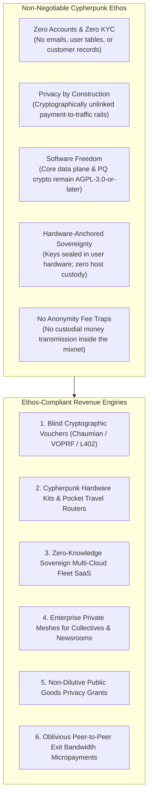
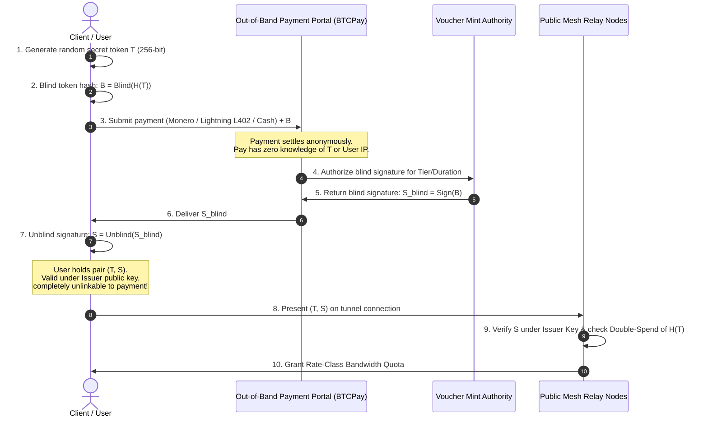
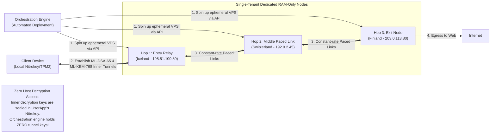
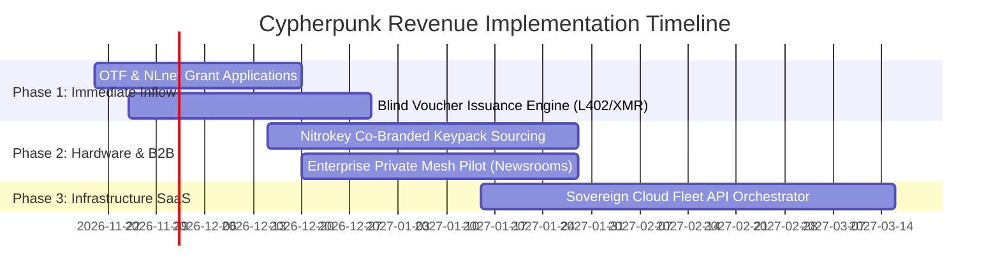

# Ethos-Preserving Revenue Architecture: Commercialization Blueprint for cypherpunk_vpn

**Document Version:** 1.0.0  
**Project:** `cypherpunk_vpn`  
**Status:** Proposal (17 Nov 2026); the owner's decision is [D020](DECISIONS.md), the checkout design [PAID_CREDITS_CHECKOUT.md](PAID_CREDITS_CHECKOUT.md). Figures below are the proposal's own and are unverified.  
**Date:** 17 November 2026  
**License:** AGPL-3.0-or-later with commercial dual licensing ([LICENSE](../LICENSE))  

---

## 1. The Cypherpunk Commercial Paradox & Core Boundary Conditions

Commercial VPNs typically generate revenue through models that directly compromise user privacy: centralized user databases (emails, hashed passwords), recurring fiat payment linkages (credit cards, PayPal, bank accounts tied to IP addresses), telemetry tracking, and predatory data monetization.

`cypherpunk_vpn` resolves this paradox by demonstrating that **high-assurance privacy and commercial sustainability are not mutually exclusive**. However, to prevent mission creep and regulatory capture, all monetization strategies must strictly adhere to the project's non-negotiable boundary conditions ([docs/PRINCIPLES.md](PRINCIPLES.md)):

### The Boundary Rules:
1. **Rule 1 (Identity Decoupling):** The payment system must never learn a member's network identity, hardware key ID (`!xxxxxxxx`), or tunnel sessions.
2. **Rule 2 (No Custodial Money Transmission):** Following the lessons of Samourai/Ashigaru/Whirlpool ([docs/COMPARISON.md](COMPARISON.md) §4.13), the routing, mixing, and cryptographic core must remain pure protocol software with no custodial fee-skimming or internal money-brokering.
3. **Rule 3 (No Open-Core Bait-and-Switch):** The Rust data plane, GotaTun/DAITA packet shaping, post-quantum crypto (`ML-DSA-65`, `ML-KEM-768`), and security fixes must never be paywalled. Commercial offerings package physical hardware, unlinked compute infrastructure, support services, and enterprise enclaves.
4. **Rule 4 (Zero Host Key Access):** In managed infrastructure models, server memory and inner encryption keys must remain sealed by the user's local hardware device (Nitrokey/TPM2). The provider must have zero cryptographic capability to decrypt customer traffic.

---

## 2. In-Depth Technical & Commercial Architecture of the 6 Models

### Model 1: Cryptographic Blind Vouchers & Privacy-Pass Subscriptions

#### The Problem It Solves
The public mesh requires members to contribute at least one relay-capable server (`cypherpunk mesh offer`). However, non-technical consumers, mobile users, and high-risk individuals often lack the technical ability, credit card, or willingness to spin up an OCI or AWS cloud VPS.

#### Operational & Cryptographic Flow
Instead of traditional accounts, users buy **unlinked cryptographic vouchers**:

#### Cryptographic Implementation Architecture
* **Underlying Primitive:** Extends the existing Chaum blind RSA-FDH system in [`tools/mesh_tokens.py`](../tools/mesh_tokens.py) and future VOPRF / lattice-based STARK membership proofs ([docs/ZK_MEMBERSHIP_DESIGN.md](ZK_MEMBERSHIP_DESIGN.md)).
* **Double-Spend Prevention:** Relays maintain an in-memory bloom filter and persistent digest ledger of `SHA-256(T)`.
* **Epoch Keys:** Issuer keys rotate every 30 days (`EPOCH_SECONDS = 86400 * 30`). Expired tokens expire cleanly without tracking users.

#### Pricing & Revenue Model
* **Tiers:**
  * *Standard Tier (500 pps, ~3.0 Mbit/s, browsing-ready):* $5 / month (€5).
  * *Fast Tier (4,000 pps, ~28 Mbit/s, streaming/large transfers):* $10 / month (€10).
  * *Line Tier (16,000 pps, ~115 Mbit/s, ultra-high-throughput):* $25 / month (€25).
* **Payment Rails:**
  * Self-hosted BTCPayServer for **Monero (XMR)** and **Bitcoin Lightning Network (L402)**.
  * Physical scratch-off cards sold by third-party privacy retailers (e.g. proxy merchants, computer security conferences, cash-by-mail distributors).

---

### Model 2: Pre-Configured Cypherpunk Hardware Kits & Travel Routers

#### The Problem It Solves
Hardware-backed identity (`!xxxxxxxx`), FIDO2 `hmac-secret` key custody, and operating system network namespace isolation are technically challenging for non-specialists to configure from scratch.

#### Product Line & Specifications

#### A. Cypherpunk Hardware Security Keypack ($79 – $119)
* **Hardware:** Custom co-branded Nitrokey 3A Mini or Nitrokey 3C NFC (partnering with Nitrokey GmbH, Germany).
* **Packaging:** Vacuum-sealed, tamper-evident holographic packaging with unique serial verification hashes.
* **Contents:**
  * Dual-interface FIDO2 / PIV / OpenPGP authenticator.
  * Offline-generated recovery seed sheet printed on tear-resistant waterproof synthetic paper.
  * Encrypted backup mini-SD card.
  * Verified firmware hash manifest (`v1.9.1+`).

#### B. Cypherpunk Travel Gateway Router ($199 – $349)
* **Hardware Architecture:** Compact, fanless ARM64 Single Board Computer (e.g., RK3568 / MT7981 quad-core Cortex-A53) with dual 2.5 GbE ports and Wi-Fi 6.
* **Firmware:** Hardened, read-only rootfs Linux (`stboot` / dm-verity) running `cypherpunk_vpn` in hardware.
* **Physical Controls:**
  * Physical 3-position toggle switch:
    * Position 1: `Kill Switch Engaged` (Hardware physical link disconnect).
    * Position 2: `Cloaked Mode` (HTTP/3 QUIC on UDP 443 with 2s TCP fallback).
    * Position 3: `Mix Lane Mode` (Sphinx async mixnet routing for extreme threat profiles).
* **Zero Client Software Burden:** Phones, laptops, and tablets connect to the router's local Wi-Fi SSID; all traffic leaving the building is automatically padded, constant-rate shaped, post-quantum encrypted, and routed over 2 or 3 sovereign hops.

#### Distribution & Logistics
* **Anonymous Fulfillment:** Orders accepted without account creation. Customers can ship to PO boxes, parcel lockers, or use pseudonymized freight forwarders.
* **Gross Margins:** 45% – 60% on hardware appliances.

---

### Model 3: Zero-Knowledge Sovereign Multi-Cloud Fleet Automation ("Sovereign Fleet SaaS")

#### The Problem It Solves
Single-operator sovereign chains ([docs/COMPARISON.md](COMPARISON.md) §1) require setting up 3 VPS instances across 3 distinct cloud providers in 3 different legal jurisdictions (e.g., Entry in Iceland, Middle in Switzerland, Exit in Finland). While [`tools/cloud.py`](../tools/cloud.py) automates the commands, managing multi-cloud provider accounts and security policies remains an operational hurdle.

#### The Zero-Knowledge Concierge Architecture
A managed subscription service ($19 to $49/month) where the user clicks "Provision Sovereign Chain":

#### Cryptographic Guarantee
1. **Single-Tenant Fleet:** Instances are provisioned exclusively for that subscriber.
2. **RAM-Only Execution:** Uses the project's zero-retention scripts (`tools/retention.py`); logs are sent to `/dev/null`, and disks run in tmpfs.
3. **Local Key Custody:** The orchestration engine only handles infrastructure provisioning (IPs, firewalls, GotaTun binary staging). **All inner tunnel keys and ML-DSA-65 identities are generated on and sealed by the user's local hardware token.** The hosting service cannot decrypt traffic even under subpoena.

---

### Model 4: Enterprise & High-Risk Team Private Meshes ("Cypherpunk for Collectives")

#### Target Market
* Investigative news organizations (e.g. International Consortium of Investigative Journalists, Forbidden Stories).
* Human rights and whistleblower defense organizations operating under active state surveillance.
* Crypto protocol core teams, high-value decentralized treasuries, and family offices.

#### Product Offering
* **Private Mesh Enclaves:** Custom deployment of private group meshes ([docs/MESH_DESIGN.md](MESH_DESIGN.md) §5) sharing a cryptographically isolated group key. Team members' traffic never touches public relays; it traverses private, dedicated, unlisted DAITA relays.
* **Continuous Adversarial Red-Teaming:** Incorporates the project's automated website fingerprinting harnesses (`tools/wf_attack.py`, `tools/gpa.py`) to benchmark and audit the organization's network traffic against correlation attacks.
* **Commercial Support & SLAs:**
  * 24/7 incident response for network blocking and censorship events.
  * Dedicated high-speed BBR-tuned exit nodes in chosen non-extradition legal spheres.
* **Pricing Structure:**
  * Small Newsroom / Team (up to 15 seats): $6,000 / year.
  * Mid-sized Organization (up to 50 seats): $18,000 / year.
  * Enterprise / Dedicated Network: $45,000+ / year.

---

### Model 5: Non-Dilutive Privacy Grants & Public Goods Funding

#### Grant Target Matrix
`cypherpunk_vpn` has implemented several cryptographic and anti-traffic-analysis innovations that qualify for public-interest research and digital freedom grants:

| Funding Body | Specific Program | Target Scope | Potential Funding |
|---|---|---|---|
| **Open Technology Fund (OTF)** | Internet Freedom Fund | Censorship circumvention, HTTP/3 camouflage, and real-website DAITA defense | $50,000 – $300,000 |
| **NLnet Foundation** | NGI0 Core & Entrust | Post-quantum ML-DSA-65 authentication and forward-private STARK zero-knowledge proofs | €20,000 – €100,000 |
| **Prototype Fund (BMBF Germany)** | Civic Tech & Security | Open-source usable security tooling and offline hardware key integration | €47,500 |
| **Zcash Community Grants (ZCG)** | ZK Tech Innovation | Advancing STARK nullifiers and zero-knowledge membership infrastructure | $25,000 – $150,000 |
| **Mozilla Technology Fund** | Privacy & Open Source | AI-resistant traffic analysis defenses and fingerprinting countermeasures | $25,000 – $75,000 |

#### Governance Alignment
Per [docs/FUNDING.md](FUNDING.md), all grants are publicly disclosed in the voluntary funding record. Grants are non-dilutive, impose no commercial constraints, and require zero compromises on AGPL-3.0-or-later open licensing.

---

### Model 6: Oblivious L402 / Cashu Exit Bandwidth Micropayment Settlement

#### The Problem It Solves
Exit nodes incur real monthly bandwidth and transit costs. The community mesh ([docs/MESH_DESIGN.md](MESH_DESIGN.md)) relies on voluntary exit node operators who bear these costs.

#### Protocol Flow
* **HTTP 402 / L402 Protocol:** When a client routes egress traffic through an exit node, the exit node challenges high-volume requests with an L402 token challenge.
* **Blind Ecash Settlement (Cashu / Fedimint):** The client attaches a blind ecash token paying for $N$ gigabytes of egress.
* **Decentralized Settlement:** The exit node redeems the ecash token directly. The project toolchain provides the open-source broker software and takes an optional 1.5% protocol development reward fee on settled bandwidth.
* **Legal Shield:** The project never holds user funds or acts as a financial intermediary; settlement occurs peer-to-peer between client and exit operator.

---

## 3. Comparative Strategic Matrix & Viability Scorecard

| Dimension | Model 1: Blind Vouchers | Model 2: Hardware Kits | Model 3: Sovereign Fleet SaaS | Model 4: Enterprise Meshes | Model 5: Grants | Model 6: Oblivious Micropay |
|---|---|---|---|---|---|---|
| **Ethos Alignment** | 100% (Pure Chaumian) | 100% (Local keys) | 100% (Zero host access) | 100% (Private enclaves) | 100% (Open research) | 95% (P2P protocol) |
| **Time to Market** | 4 – 6 Weeks | 6 – 10 Weeks | 8 – 12 Weeks | 3 – 5 Weeks | 8 – 16 Weeks | 16+ Weeks |
| **Revenue Predictability** | High (Recurring) | Moderate (One-time) | High (Recurring) | High (Annual contracts) | Moderate (Milestones) | Variable (Usage-based) |
| **Target Audience** | Privacy Consumers | Enthusiasts/Travelers | Sovereignty Seekers | Newsrooms/NGOs | Research Foundations | Community Operators |
| **Operational Overhead** | Low (Automated) | High (Fulfillment) | Medium (Cloud APIs) | Medium (SLA Support) | Low (Reporting) | Low (Autonomous) |

---

## 4. Execution Roadmap: From Planning to Operational Revenue

### Next Steps (Zero Code Impact on Core VPN):
1. **Grant Submissions:** Prepare technical dossiers for OTF Internet Freedom Fund and NLnet NGI0 Entrust based on `docs/PQ_INVENTORY.md` and `docs/evidence/RATE_CLASSES_v0_10_1.json`.
2. **Payment Gateway Staging:** Deploy an isolated, self-hosted BTCPayServer instance handling Monero and Lightning L402 connected to `tools/mesh_tokens.py`.
3. **Hardware Partnership Initiation:** Reach out to Nitrokey GmbH to discuss bulk procurement of Nitrokey 3A Mini/NFC units for pre-packaged Cypherpunk Security Packs.
4. **Newsroom Outreach:** Prepare a whitepaper tailored for investigative collectives demonstrating the anti-fingerprinting guarantees of `cypherpunk_vpn` compared to traditional commercial VPNs.
