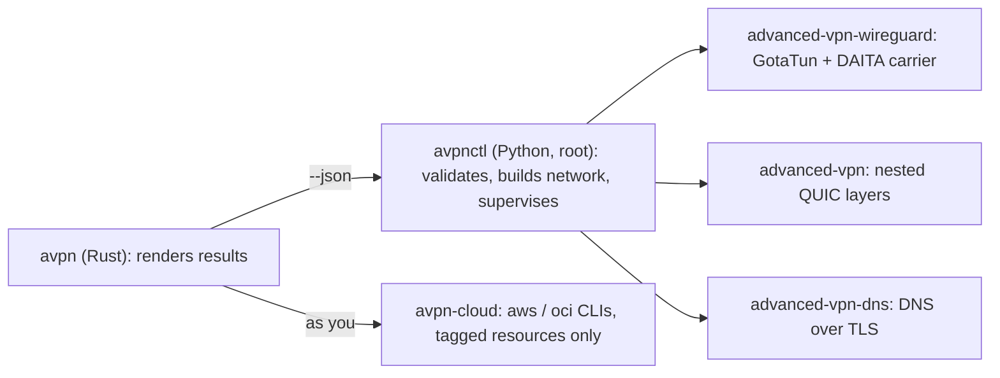

# Architecture

## Processes

- **`avpn`** never runs privileged logic itself. It calls the controller with `--json` and renders the single result object. When it runs as root, it only executes root-owned, write-protected programs.
- **The controller** owns everything privileged: keys, nftables, namespaces, routes and supervision. Data-plane children run under an unprivileged service UID with no capabilities. They receive keys through sealed memfds and die with their supervisor.
- **`avpn-cloud`** uses your own provider sign-in. It touches only the resources it tagged.

## Data path

See `avpn help chains`:
- one QUIC layer per server hop (X25519MLKEM768, ML-DSA-65), nested inside-out;
- the WireGuard + DAITA carrier innermost on the client's link;
- the inner IP MTU is 1100 for every chain length;
- the WireGuard carrier keeps a persistent keepalive, so the chain survives roaming between networks (`avpn help threat-model`).

## Threat model

See `avpn help threat-model`:
- the design is a multi-party relay (like iCloud Private Relay) using the MASQUE
  QUIC-datagram mechanism, with post-quantum mutual authentication and DAITA traffic
  shaping that OHTTP, MASQUE and Private Relay do not have;
- the honest limits are global-passive flow correlation (DeepCorr/Var-CNN) and the
  non-collusion assumption; constant-cell padding reduces, but does not erase, what an
  observer can learn.

## Keys

See `avpn help keys`:
- keys are generated on each device and sealed to a Nitrokey, or to TPM2 + host;
- the operator signs with a hybrid FIDO2 Ed25519 + ML-DSA-65 key;
- bundles contain no private keys.

## What servers keep

See `avpn help retention`:
- runtime state lives in RAM only;
- server units run with `LogLevelMax=emerg`;
- servers keep no byte counters.

## What hops can see

See `avpn help privacy`:
- the first hop sees your address, unless upstream entry routes it through another network;
- the exit sees destinations, but not you.

## Reference

- One page per command: [`docs/cli/`](cli/), also available as `avpn help`.
- Rust API documentation: `cargo doc --open` (every public item is documented; `#![deny(missing_docs)]`).
- Python: every public function in the product modules has a docstring (ruff `D1`, enforced in CI).
